**SEO Specialist · Content Writer · Digital Marketer · Python & Django Learner**

*5+ years of creating SEO-driven content that improves brand visibility, organic traffic and search rankings, now building Python and Django skills to combine marketing with web development.*

I'm an SEO Specialist, Content Writer and Digital Marketing professional with 5+ years of experience. I create well-researched, SEO-optimized content and use keyword research, on-page SEO, competitor analysis and performance data to improve search visibility. Alongside my marketing work, I'm building a technical foundation in Python, Django and HTML so I can understand how websites are built and make better technical SEO decisions.

- **SEO:** technical SEO, keyword research, on-page optimization, competitor analysis and reporting
- **Content:** blogs, website copy, knowledge-base articles, and video / YouTube / promotional scripts
- **Python & Django:** learning Python programming and Django web development, including models, views, templates and URL routing
- **HTML:** writing clean, semantic HTML5 for SEO (headings, meta tags, structured content)
- **Teaching:** worked as an Instructor, turning technical concepts into clear learning material
- **Languages:** English (communication) · Urdu (native)

| Role | Company | Period | What I did |
|---|---|---|---|
| Content Writer | **Deviora LLC** (Remote) | Jul 2025 – Jun 2026 | SEO-optimized blogs, articles and web content on technology, business solutions and digital innovation; worked with the marketing team on campaign goals |
| Content Writer, Digital Marketer & SEO (Instructor) | **Wise Tech Innovates** | Jun 2024 – Jul 2025 | Delivered training sessions, produced SEO content, ran digital marketing initiatives |
| SEO Specialist | **AIRIDev** (Remote, Full-time) | Mar 2023 – Jun 2024 | SEO strategy, technical audits, on-page work, backlink management, reporting with GA, GSC, Ahrefs and SEMrush |
| Content Writer | **Desired Technology Services** (On-site, Full-time) | Jan 2022 – Mar 2023 | Blogs, website content, knowledge-base articles and guides on technology and IT trends |
| SEO & Digital Marketing Assistant | **Ghazwa Collection** (Remote) | 2021 – 2022 | Keyword research, competitor analysis, content audits, performance reports |
| Freelance Content Writer & Script Writer | **Remote** | 2020 – Present | SEO content for blogs, websites, landing pages and social media; scripts for videos and YouTube |

Currently building skills in Python, Django and HTML5 to complement my SEO and content work.

**SEO & Analytics**

**Programming**

-E34F26?style=for-the-badge&logo=html5&logoColor=white)

**Productivity & Collaboration**

| Area | Competencies |
|---|---|
| **SEO** | Technical SEO · Keyword research · On-page optimization · Competitor analysis · Backlink management · SEO reporting |
| **Content** | Content strategy · Blog & web writing · Script writing (video, YouTube, promo) · Proofreading & editing · Content planning & scheduling |
| **Technical** | Python (learning) · Django (learning) · HTML5 for SEO |
| **Digital Marketing** | Marketing campaigns · Performance analysis · CRM basics |
| **Working Style** | Corporate communication · Attention to detail · Problem solving · Time management · Agile workflows |
| **Languages** | English (communication) · Urdu (native) |

**Education**

| Program | Institute | Years |
|---|---|---|
| Bachelor of Science in Information Technology (BSIT) | Virtual University of Pakistan | 2024 – 2027 |
| Intermediate (Computer Science) | The Educators College, Sahiwal | 2019 – 2021 |
| Matriculation (Science Group) | Divisional Public School & College, Sahiwal | — |

**Certifications & Training**

| Certification | Issuer |
|---|---|
| Content Marketing Fundamentals | HubSpot Academy |
| SEO Fundamentals | SEMrush Academy |
| Digital Marketing Certification | Digiskills |
| Data Analytics & Business Intelligence | Digiskills |
| Diploma in Office Operations (2024) | Sahiwal, Pakistan |

Thanks for visiting my profile.

